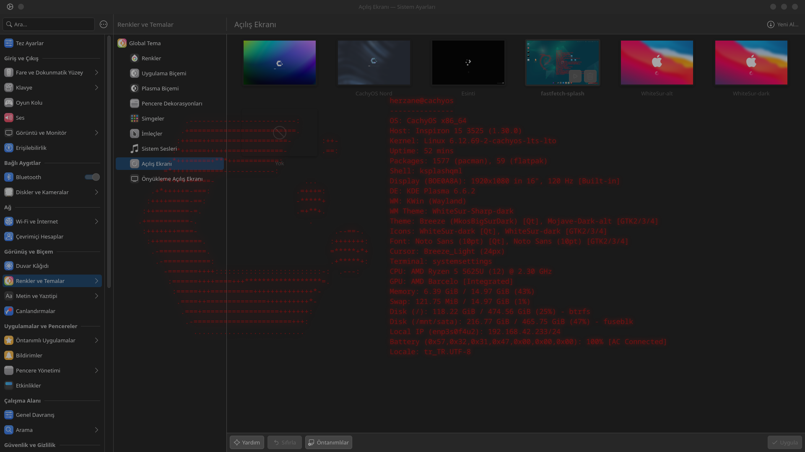
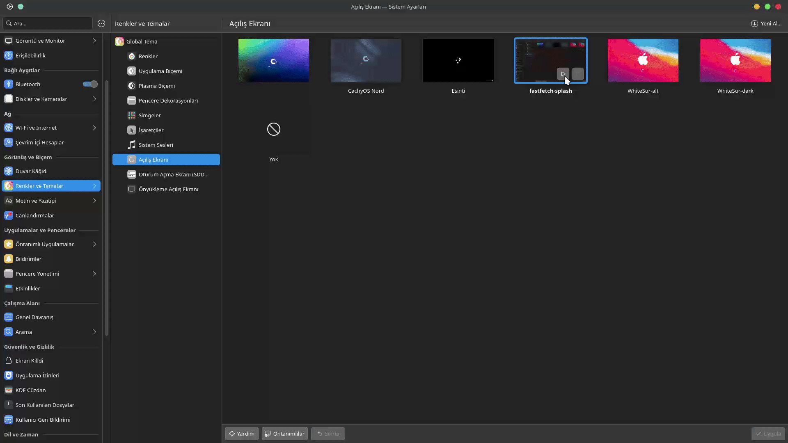
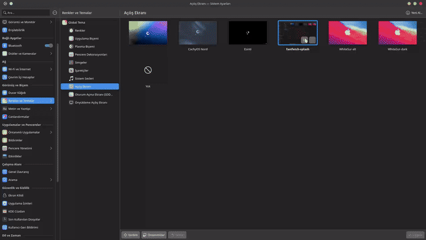
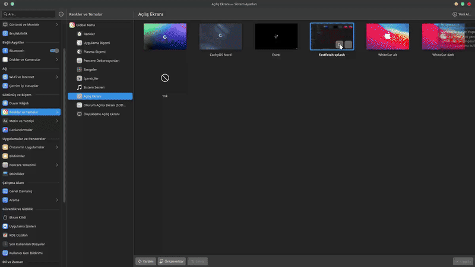
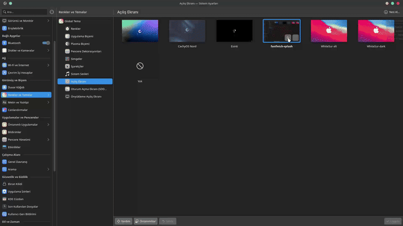
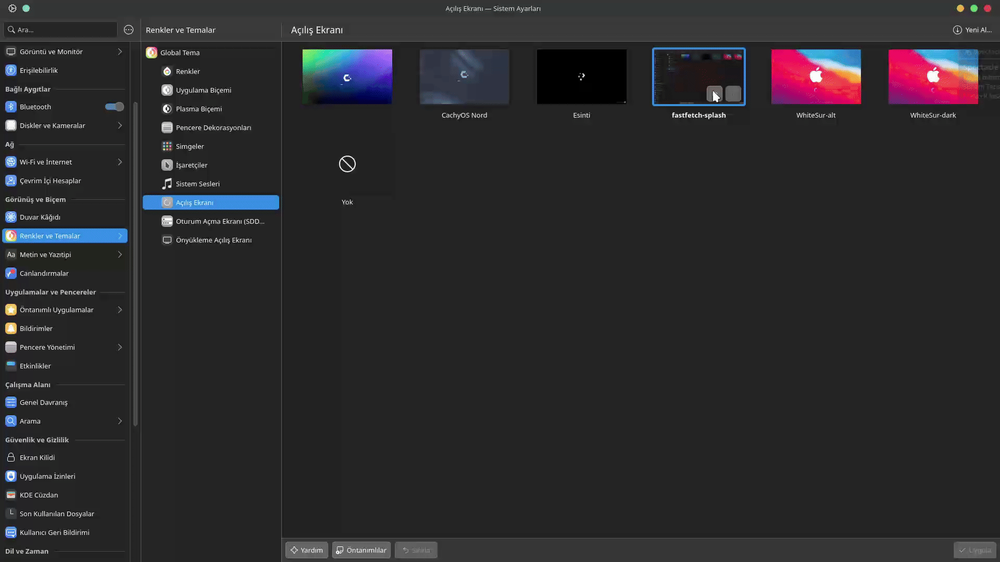
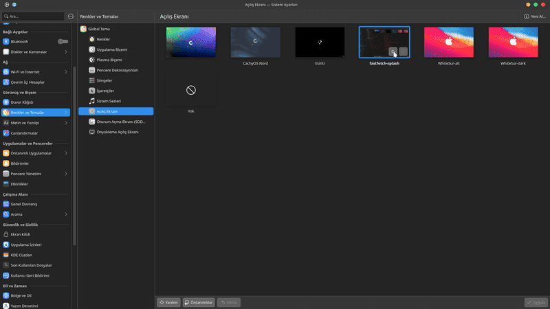
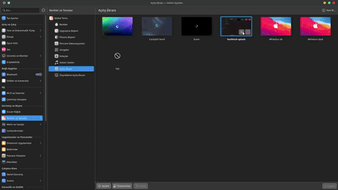
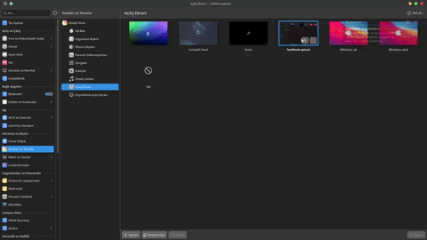

<h1 align="center">Fastfetch KDE Splash</h1>

<p align="center">
  
</p>

<div align="center">
  <table>
    <tr>
      <th width="50%" align="center"><h3>Fedora - Logo Only</h3></th>
      <th width="50%" align="center"><h3>Arch - Logo + System Info</h3></th>
    </tr>
    <tr>
      <td align="center">
        
      </td>
      <td align="center">
        
      </td>
    </tr>
  </table>

  <details>
    <summary><b>🔍 More previews (click)</b></summary>
    <br>
    <table>
      <tr>
        <th width="50%" align="center"><h3>Custom ASCII Logo</h3></th>
        <th width="50%" align="center"><h3>System Info Only</h3></th>
      </tr>
      <tr>
        <td align="center">
          
        </td>
        <td align="center">
          
        </td>
      </tr>
      <tr>
        <th width="50%" align="center"><h3>KDE Linux Logo</h3></th>
        <th width="50%" align="center"><h3>Debian - Logo Only</h3></th>
      </tr>
      <tr>
        <td align="center">
          
        </td>
        <td align="center">
          
        </td>
      </tr>
      <tr>
        <th width="50%" align="center"><h3>CachyOS - Transparent Background (Logo + System Info)</h3></th>
        <th width="50%" align="center"><h3>CachyOS - Logo Only</h3></th>
      </tr>
      <tr>
        <td align="center">
          
        </td>
        <td align="center">
          
        </td>
      </tr>
    </table>
  </details>
</div>

## <p align="center">A "hacker/matrix style" splash animation for KDE Plasma using <code>fastfetch</code>.</p>

## <p align="center"><strong>English</strong> | <strong><a href="README.tr.md">Türkçe</a></strong></p>

<p align="center">
  <a href="https://kde.org/plasma-desktop/"></a>
  <a href="https://doc.qt.io/qt-6/qmlapplications.html"></a>
  <a href="https://www.gnu.org/software/bash/"></a>
  <a href="https://github.com/fastfetch-cli/fastfetch"></a>
</p>

## Features

*   **Color Selection:** You can pick any color you like (the theme color).
*   **Logo & Info Layouts:** Logo only, logo + system info ("full"), or system info only ("info").
*   **Background Settings:** Set a background color or make it transparent.
*   **TUI & CLI Installer:** Easy setup from the terminal or the visual TUI menu, with multi-language support.
*   **Custom Logo Support:** fastfetch logos or a custom ASCII logo.
*   **Choose Your Distro Logo:** During installation all fastfetch distro logos are listed; search for the distro you want, select it, and preview it before confirming.
*   **Your Own ASCII Logo:** Add your ASCII logo to the `ascii-logo.txt` file in the project root and pick the "ASCII" option during installation.

## Requirements

*   **KDE Plasma:** Version 6.
*   **Fastfetch:** Must be installed on your system.
*   **Qt5Compat.GraphicalEffects:** Required for visual effects.

##  Installation and Configuration

### 1. Using the Installation Script (Recommended)

The `install.sh` script automates everything:
*   Asks for your preferences (color, layout, background).
*   Copies the files to the correct directory (`~/.local/share/plasma/look-and-feel/fastfetch-splash`).
*   Automatically completes the configuration.

```bash
# to clone the repository
git clone https://github.com/herzane52/fastfetch-kde-splash.git
cd fastfetch-kde-splash
```
```bash
# give execute permission
chmod +x install.sh install-tui.sh
# run installer (automatically opens TUI if whiptail is installed, otherwise continues in CLI)
./install.sh
```

```bash
# to run in CLI mode directly even if whiptail is installed
./install.sh --cli
```

### 2. Manual Customization (or KDE Store Users)

If you installed the theme via the KDE Store, it works out of the box with default settings. To customize the settings (color, layout, background), edit the file manually:

```bash
nano ~/.local/share/plasma/look-and-feel/fastfetch-splash/contents/splash/Splash.qml
```

###  Usage

1.  Open **System Settings**.
2.  Go to the **Appearance > Splash Screen** tab.
3.  Select **fastfetch-splash** from the list and click **Apply**.

## Development and Quick Test

You can quickly test the splash screen using the `ksplashqml` tool. From the project directory:

```bash
ksplashqml "$PWD"
```

##  Troubleshooting

*   **"'fastfetch' not found" Error:** `fastfetch` is not installed on your system. Install it using your distribution's package manager (e.g., `sudo pacman -S fastfetch` or `sudo apt install fastfetch`).

*   **"'fastfetch' returned empty output" Error:** The command is running but not returning any output. Make sure `fastfetch --structure L --pipe` works correctly in your terminal.

*   **Visual Glitches/Issues:** If effects (neon glow, glitch, etc.) are invisible, make sure the `Qt5Compat.GraphicalEffects` package is installed. Package names differ per distribution: Arch/Manjaro → `qt6-5compat`, Fedora → `qt6-qt5compat`, Debian/Ubuntu → `qml6-module-qt5compat-graphicaleffects`.

*   **Theme Not Showing in the List:** Run `install.sh` again. If it still does not appear, test the project with `ksplashqml`, check the theme directory (`~/.local/share/plasma/look-and-feel/fastfetch-splash`), and close and reopen the System Settings window.
