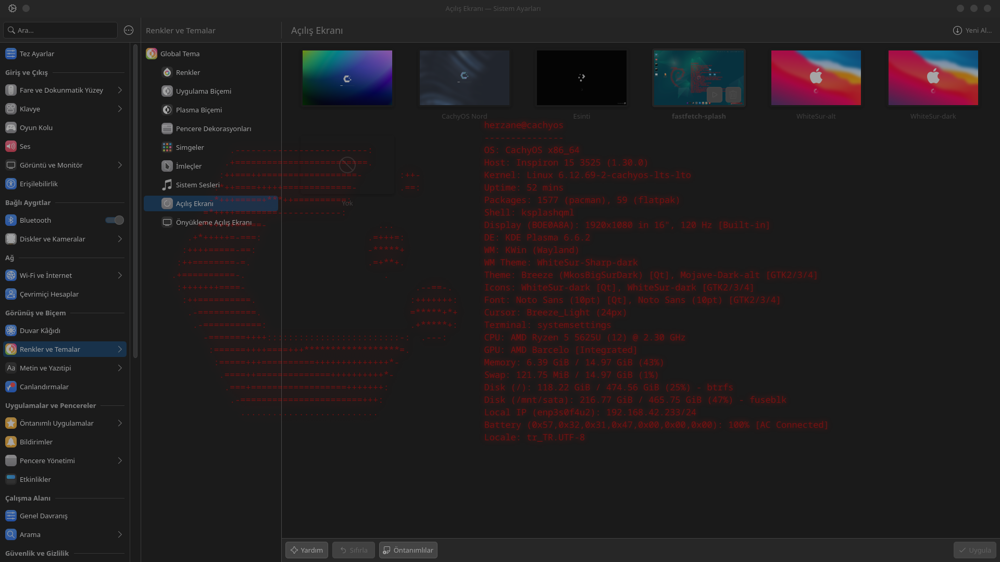
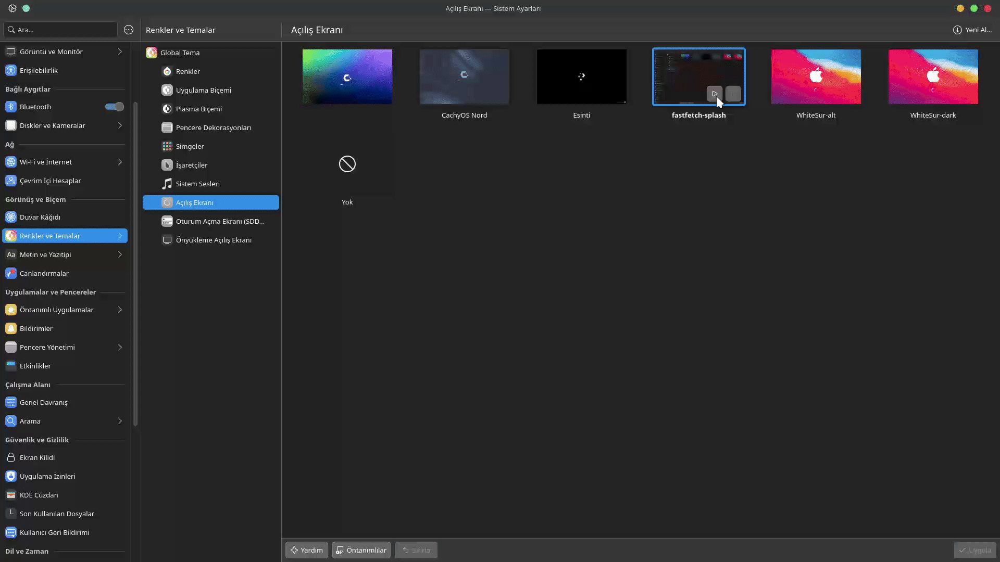
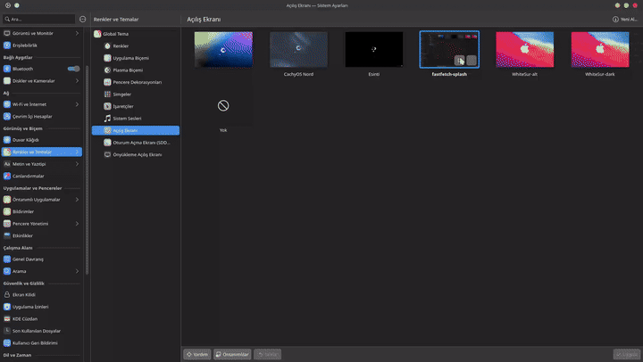
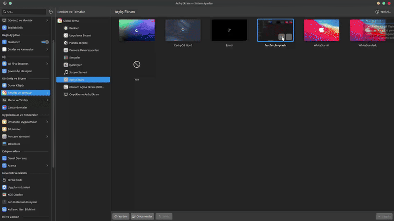
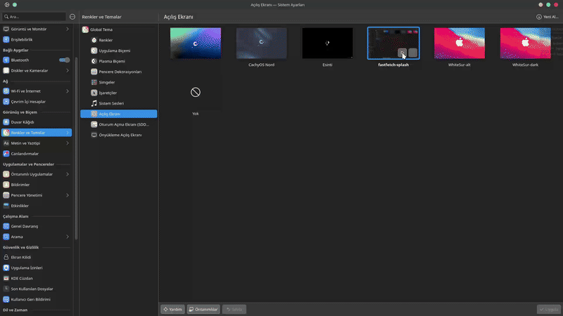
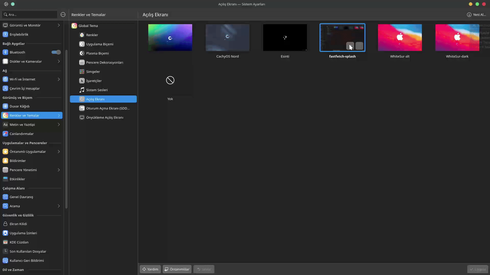
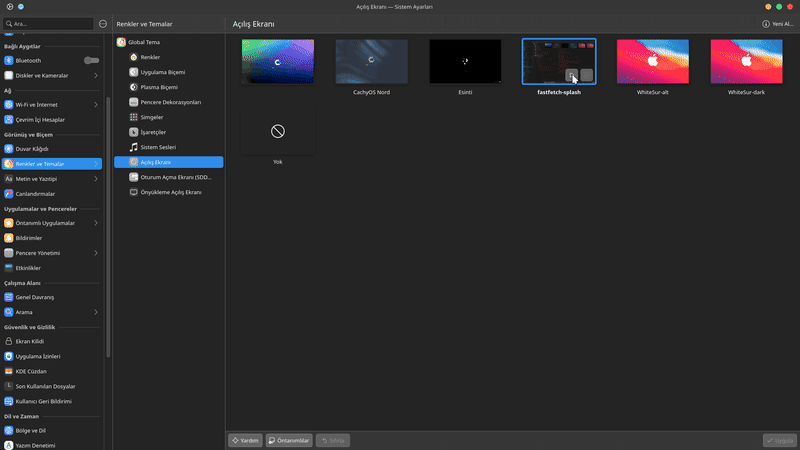
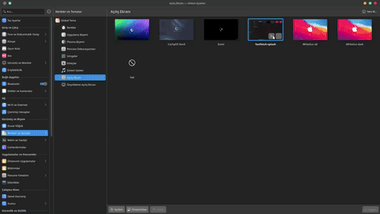
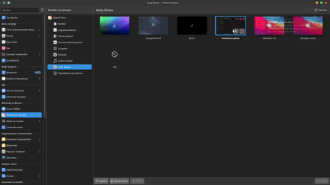

<h1 align="center">Fastfetch KDE Splash</h1>

<p align="center">
  
</p>

<div align="center">
  <table>
    <tr>
      <th width="50%" align="center"><h3>Fedora - Sadece Logo</h3></th>
      <th width="50%" align="center"><h3>Arch - Logo + Sistem Bilgisi</h3></th>
    </tr>
    <tr>
      <td align="center">
        
      </td>
      <td align="center">
        
      </td>
    </tr>
  </table>

  <details>
    <summary><b>🔍 Diğer önizlemeler (tıkla)</b></summary>
    <br>
    <table>
      <tr>
        <th width="50%" align="center"><h3>Özel ASCII Logo</h3></th>
        <th width="50%" align="center"><h3>Sadece Sistem Bilgisi</h3></th>
      </tr>
      <tr>
        <td align="center">
          
        </td>
        <td align="center">
          
        </td>
      </tr>
      <tr>
        <th width="50%" align="center"><h3>KDE Linux Logosu</h3></th>
        <th width="50%" align="center"><h3>Debian- Sadece Logo</h3></th>
      </tr>
      <tr>
        <td align="center">
          
        </td>
        <td align="center">
          
        </td>
      </tr>
      <tr>
        <th width="50%" align="center"><h3>CachyOS - Şeffaf Arka Plan (Logo + Sistem Bilgisi)</h3></th>
        <th width="50%" align="center"><h3>CachyOS - Sadece Logo</h3></th>
      </tr>
      <tr>
        <td align="center">
          
        </td>
        <td align="center">
          
        </td>
      </tr>
    </table>
  </details>
</div>

## <p align="center">KDE Plasma için <code>fastfetch</code> ile "hacker/matrix" tarzında açılış animasyonu.</p>

## <p align="center"><strong><a href="README.md">English</a></strong> | <strong>Türkçe</strong></p>

<p align="center">
  <a href="https://kde.org/plasma-desktop/"></a>
  <a href="https://doc.qt.io/qt-6/qmlapplications.html"></a>
  <a href="https://www.gnu.org/software/bash/"></a>
  <a href="https://github.com/fastfetch-cli/fastfetch"></a>
</p>

## Özellikler

*   **Renk Seçimi:** İstediğiniz herhangi bir rengi (tema rengini) seçebilirsiniz.
*   **Logo & Bilgi Düzenleri:** Sadece logo, logo + sistem bilgisi ("full") veya sadece sistem bilgisi ("info").
*   **Arka Plan Ayarları:** Arka plan rengini belirleyebilir veya şeffaf olarak yapabilirsiniz.
*   **TUI & CLI İle Kurulum:** Çoklu dil desteğiyle ister terminalden ister görsel TUI menüsüyle kolay kurulum.
*   **Özel Logo Desteği:** Fastfetch logoları veya özel ASCII logosu desteği.
*   **Distro Logonuzu Seçin:** Kurulum sırasında fastfetch'in tüm distro logoları listelenir; istediğiniz distroyu arayıp seçebilir, seçmeden önce önizleyebilirsiniz.
*   **Kendi ASCII Logonuz:** ASCII logonuzu proje kökündeki `ascii-logo.txt` dosyasına ekleyin; kurulumda "ASCII" seçeneğini seçin.

## Gereksinimler

*   **KDE Plasma:** 6 sürümü.
*   **Fastfetch:** Sisteminizde kurulu olmalıdır.
*   **Qt5Compat.GraphicalEffects:** Görsel efektler için gereklidir.

##  Kurulum ve Yapılandırma

### 1. Kurulum Betiği ile (Önerilen)

`install.sh` betiği tüm işlemleri otomatikleştirir:
*   Tercihlerinizi (renk, düzen, arka plan) sorar.
*   Dosyaları doğru dizine (`~/.local/share/plasma/look-and-feel/fastfetch-splash`) kopyalar.
*   Yapılandırmayı otomatik olarak tamamlar.

```bash
# depoyu klonlamak için
git clone https://github.com/herzane52/fastfetch-kde-splash.git
cd fastfetch-kde-splash
```
```bash
# çalıştırma izni vermek için
chmod +x install.sh install-tui.sh
# kurulum betiğini çalıştırmak için (whiptail varsa otomatik TUI açılır, yoksa CLI ile devam eder)
./install.sh
```

```bash
# whiptail olsa bile doğrudan CLI modunda çalıştırmak için
./install.sh --cli
```

### 2. Manuel (Elle) Yapılandırma (veya Mağaza Kullanıcıları)

Temayı KDE Store üzerinden kurduysanız varsayılan ayarlarla doğrudan çalışır. Ayarları (renk, düzen, arka plan) özelleştirmek isterseniz dosyayı elle düzenleyin:

```bash
nano ~/.local/share/plasma/look-and-feel/fastfetch-splash/contents/splash/Splash.qml
```

###  Kullanım

1.  **Sistem Ayarları**'nı açın.
2.  **Görünüm > Açılış Ekranı** sekmesine gidin.
3.  Listeden **fastfetch-splash** öğesini seçin ve **Uygula**'ya tıklayın.

## Geliştirme ve Hızlı Test

Projeyi hızlıca test etmek için `ksplashqml` aracını kullanabilirsiniz. Proje dizinindeyken:

```bash
ksplashqml "$PWD"
```

##  Hata Çözümleri

*   **"'fastfetch' not found" Hatası:** Sisteminizde `fastfetch` yüklü değildir. Dağıtımınızın paket yöneticisini kullanarak (`sudo pacman -S fastfetch` veya `sudo apt install fastfetch` gibi) yükleme yapın.

*   **"'fastfetch' returned empty output" Hatası:** Komut çalışıyor ancak çıktı veremiyor. Uçbirimde `fastfetch --structure L --pipe` komutunun normal çalıştığından emin olun.

*   **Görsel Hatalar/Eksiklikler:** Eğer efektler (neon parlama, glitch vb.) görünmüyorsa `Qt5Compat.GraphicalEffects` paketinin kurulu olduğundan emin olun. Paket adları dağıtıma göre farklıdır: Arch/Manjaro → `qt6-5compat`, Fedora → `qt6-qt5compat`, Debian/Ubuntu → `qml6-module-qt5compat-graphicaleffects`.

*   **Tema Listede Görünmüyor:** `install.sh`'i tekrar çalıştırın. Hâlâ görünmüyorsanız `ksplashqml` ile projeyi test edin; tema dizinini (`~/.local/share/plasma/look-and-feel/fastfetch-splash`) kontrol edin ve System Settings penceresini kapatıp yeniden açın.
